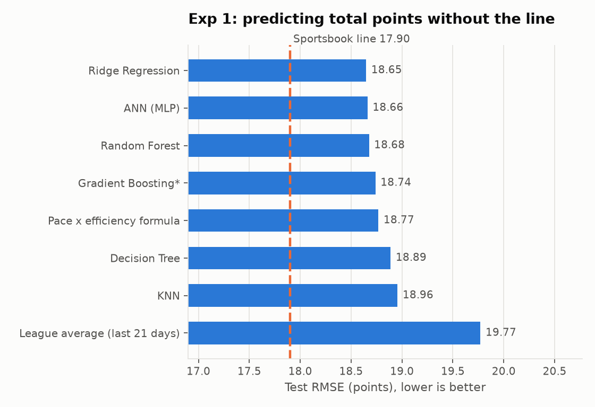
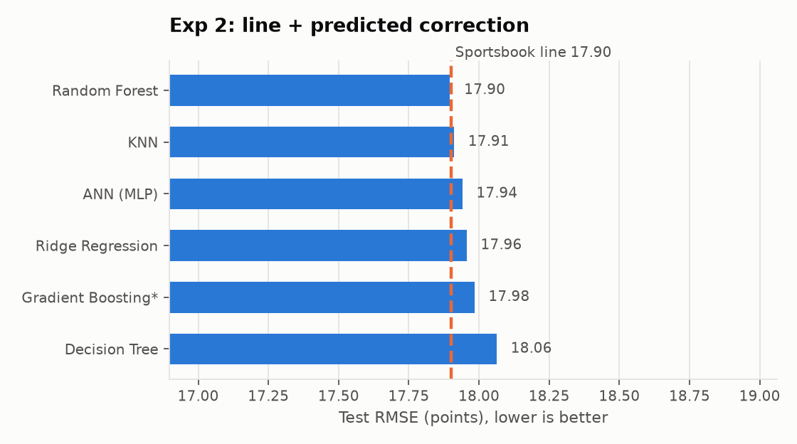
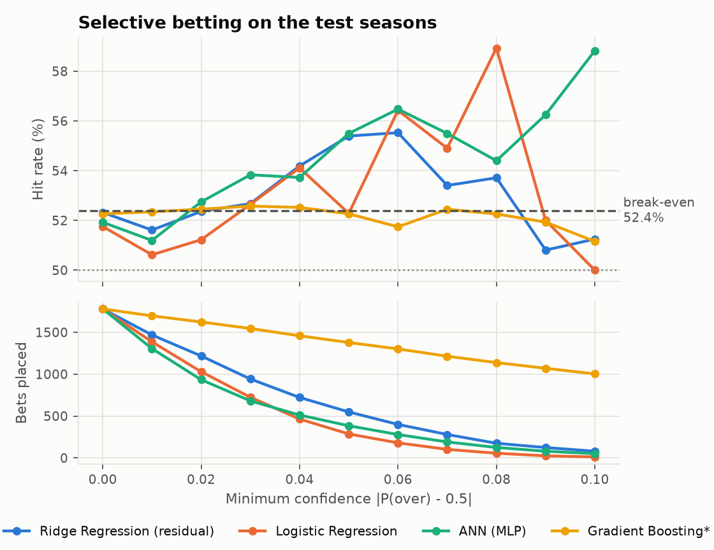
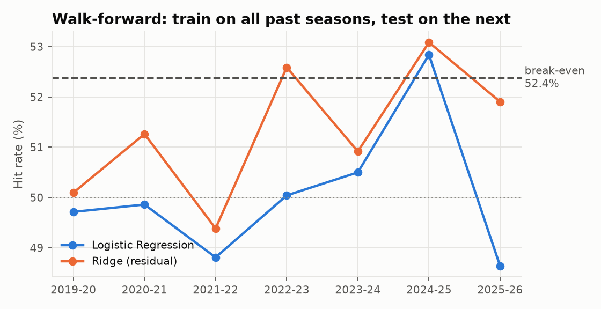
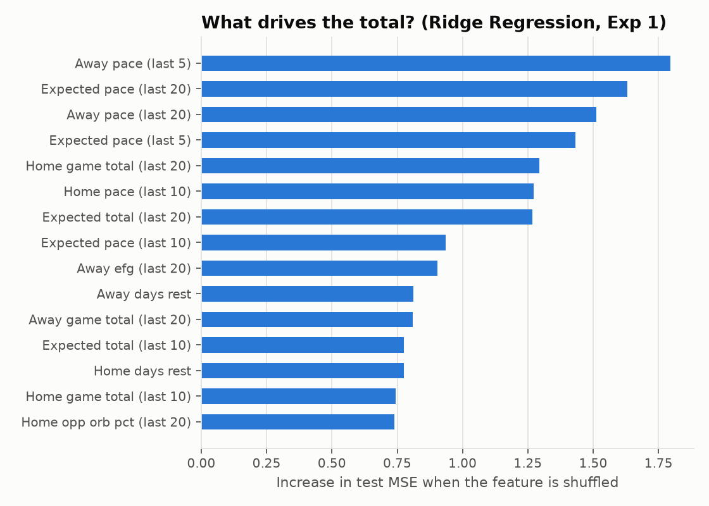
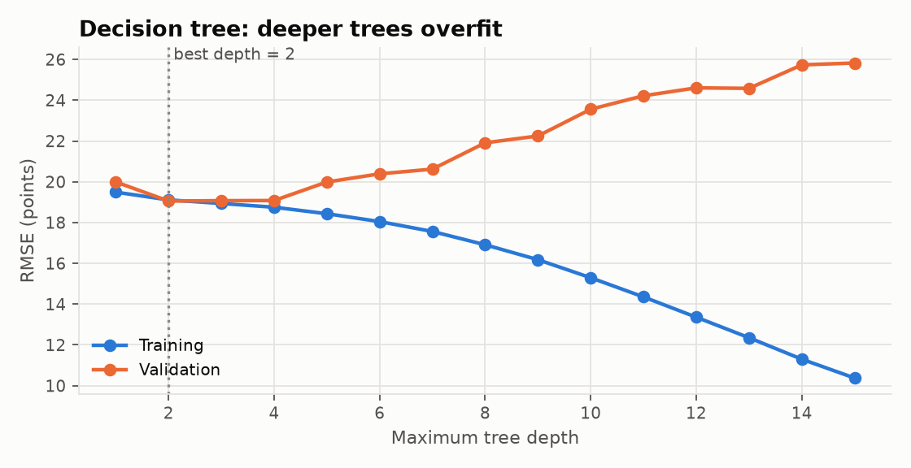

# Beating the Over/Under? NBA total-points prediction

UE24CS352A Machine Learning mini-project. We revisit **"The Bank is Open: AI in Sports
Gambling"** (Bucquet & Sarukkai, Stanford CS229), which predicts the total points scored in
an NBA game and tries to beat the sportsbooks' Over/Under line.

## What we do differently from the paper

| | Paper | This project |
|---|---|---|
| Data | 2012-13 to 2017-18 | **2017-18 to 2025-26** (recent, higher-scoring era) |
| Features | Raw stats from each team's last 3 games (1,524 features) | Rolling 5/10/20-game averages of **pace, offensive/defensive rating and Dean Oliver's Four Factors**, rest/back-to-back flags, a pace x efficiency "expected total" (94 features) |
| Sportsbook line | Only used for evaluation | **Modelled against**: used as an input, models predict the line's error (Exp 2) or classify over/under directly (Exp 3) |
| Betting evaluation | One hit rate (51.5%) | Profit at -110 odds, **selective betting** with a threshold chosen on the validation season, binomial tests and bootstrap confidence intervals |
| Models | Random Forest, SVD, MLP, LSTM | Course models: **Logistic Regression, SVM, KNN, Decision Tree, ANN**, plus Ridge, Random Forest and Gradient Boosting for comparison |

## Results

Test set: 1,779 games (2024-25 and 2025-26 up to Jan 2026). The sportsbook line's test MSE is
**320.4** (RMSE 17.9 points). The paper's line MSE was 320.7, so the bar is the same height.

**1. Without the line, we close almost half of the paper's gap to the bookmaker.**

| | Best model MSE | Line MSE | Gap |
|---|---|---|---|
| Paper (MLP, 2017-18 test season) | 369.8 | 320.7 | 49.1 |
| Ours (Ridge / ANN / RF, 2024-26 test seasons) | **347.7** | 320.4 | **27.3** |

A one-line domain formula, *expected pace x expected efficiency*, gets 352.3 on its own and
beats KNN and the decision tree. The most important features are all **pace** features
(`feature_importance.png`).

**2. Modelling against the line: the models end up agreeing with the line.**
With the line as an input, the best model (Random Forest, MSE 320.3) only ties the line
(320.4). Everything in public box scores already appears to be priced in.

**3. Over/under classification is close to a coin flip.** Test AUC ranges from 0.49 to 0.52.
The best accuracy is 52.3% (Gradient Boosting\*), then ANN 51.9% and Logistic Regression 51.8%.

**4. Betting: some promising selective edges, none statistically significant.**
- Betting every game, the best hit rate is 52.5% (Gradient Boosting\* residual model). That is essentially *at* the 52.38% break-even: ROI +0.2%, p = 0.47.
- Selective betting with Logistic Regression (bet only when |P(over) - 0.5| >= 0.06, a threshold picked on 2023-24) won **56.4% of 180 bets, ROI +7.7%**. However, the 95% bootstrap CI is [-6.6%, +22.0%] and p = 0.16 against break-even, so this could be luck.
- Walk-forward over 7 seasons: hit rates of 49-53%, and the Ridge correction never beats the line's RMSE in any season.

**Conclusion.** Recent data and basketball-specific features (pace, ratings, Four Factors)
make the models much better than the paper's at *predicting scores*. But the sportsbook's
Over/Under line is an efficient market. Public team statistics do not contain a reliably
exploitable edge, and honest evaluation (held-out seasons, significance tests) shows that
headline numbers like "51.5%" or "56%" need confidence intervals before anyone bets on them.
Player-level information (injuries, rest days of stars) and line movement are the most
likely places a real edge could come from.

| | |
|---|---|
|  |  |
|  |  |
|  |  |

Full tables: [`results/summary.md`](results/summary.md). Figures: [`results/figures/`](results/figures).

## Setup

Requires [uv](https://docs.astral.sh/uv/) (it installs Python 3.13 and all packages).

```bash
git clone https://github.com/8bitGuitar/nba-over-under.git
cd nba-over-under
uv sync
```

Without uv (Python 3.13):

```bash
python3.13 -m venv .venv && source .venv/bin/activate
pip install -r requirements.txt
python -m src.run_experiments
```

## Running

```bash
uv run python -m src.fetch_data        # download raw data (already included in data/raw)
uv run python -m src.build_dataset     # clean, engineer features, merge lines  (~10 s)
uv run python -m src.run_experiments   # all experiments, tables and figures    (~10 min)
uv run python -m src.run_experiments --quick   # smoke test with tiny grids     (~3 min)
```

Outputs go to `results/` (CSV tables and `summary.md`) and `results/figures/` (PNGs).

## Data

| Source | What | Notes |
|---|---|---|
| NBA stats API via [`nba_api`](https://github.com/swar/nba_api) | Team box scores for every regular-season game, 2016-17 to 2025-26 | 2016-17 is only used to warm up the rolling features |
| [kyleskom/NBA-Machine-Learning-Sports-Betting](https://github.com/kyleskom/NBA-Machine-Learning-Sports-Betting) `OddsData.sqlite` | Over/Under line and spread per game | Replaces the paper's source (Sports Book Review Online), which is now offline. Lines available to Jan 7 2026. |

Cleaning: team names unified, neutral-site games (NBA Cup, international games) assigned a
single home team, 10 games with corrupted lines dropped, games without 20 games of history dropped.
Final dataset: **10,027 games**, of which 99%+ have a matched line.

**Split (chronological, never random):**
- Train: 2017-18 to 2022-23 (7,034 games)
- Validation: 2023-24 (1,214 games), used for all hyperparameter and threshold choices
- Test: 2024-25 and 2025-26 to Jan 2026 (1,779 games), touched once at the end

Every feature is computed only from games played **before** the game being predicted
(rolling windows are shifted by one game).

## Method

### Features (per team, rolling over the last 5, 10 and 20 games)
- **Pace**: possessions per 48 minutes. Possessions = FGA + 0.44 x FTA - OREB + TOV.
- **Offensive / defensive rating**: points scored / allowed per 100 possessions.
- **Four Factors** for offence and defence: effective FG%, turnover %, offensive rebound %, free-throw rate. Plus 3-point attempt rate.
- **Rest**: days since last game, back-to-back, 3 games in 4 nights.
- **Matchup**: expected pace and expected total = pace x (offence vs opponent's defence).
- **League context**: average game total over the last 21 days (scoring trend).
- **Line features** (Exp 2 and 3): line, spread, and the gap between our estimates and the line.

### Experiments
1. **Exp 1, paper setup**: predict total points from stats only and compare MSE to the line.
2. **Exp 2, model against the line**: predict `total - line` (the line's error). The prediction becomes `line + correction`. A Gaussian error model turns the correction into P(over).
3. **Exp 3, classification**: predict over vs under directly (pushes excluded). Metrics: accuracy, precision, recall, F1, ROC-AUC.
4. **Betting**: flat 1-unit bets at -110 (break-even 52.38%). **Selective betting** places a bet only when |P(over) - 0.5| is at least a threshold picked on the validation season.

### Syllabus tie-ins
- **Decision tree overfitting**: train vs validation error as depth grows (`tree_depth_overfitting.png`).
- **ANN optimizers**: GD, SGD, Momentum, Adagrad and Adam on the same network (`ann_optimizers.png`).
- **Cross-validation strategy**: walk-forward validation, training on all past seasons and testing on the next (`walk_forward.png`).
- **Performance metrics**: ROC/AUC, precision and recall for the over/under classifiers (`roc_curves.png`).

## Project structure

```
src/
  config.py           paths, seasons, split, betting constants
  fetch_data.py       download odds + box scores
  build_dataset.py    cleaning, Four Factors, rolling features, merge with lines
  features.py         feature sets and chronological split
  models.py           model zoo + validation-season grid search
  ann.py              PyTorch MLP with selectable optimizer (sklearn-compatible)
  evaluate.py         regression metrics, betting P&L, significance tests
  plots.py            figures
  run_experiments.py  runs everything, writes results/
data/raw/             downloaded data (committed so the project runs offline)
results/              tables, summary.md, figures/
```
